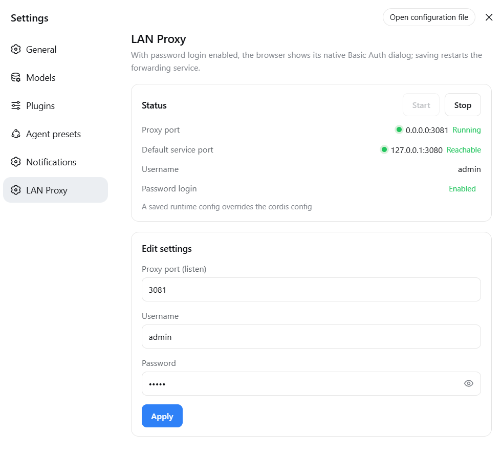

# dsh-proxy

English | [中文](README.md)

An HTTP + WebSocket reverse proxy that forwards a LAN port to the local DSH service `127.0.0.1:3080`.
Supports Basic Auth, LAN access, and `crypto.randomUUID` polyfill injection.

## DSH plugin (recommended · dsh-proxy)

**Recommended for DSH (DeepSeek Harness) users**: install the proxy as a plugin into the `web` or `desktop` profile — it **starts and stops with `dsh web` / the desktop app**, no separate process or downloadable binary needed, with a full settings page.

- Same native **Basic Auth** (browser dialog) and full HTTP + WebSocket forwarding as the standalone builds
- **Settings page** (DSH settings → LAN Proxy): status lights, start/stop, edit the proxy listen port, username, password, and the token-free-login toggle (form pre-fills current values; empty means set blank)
- Empty credentials by default = password login off; password login turns on only when **both** username and password are set
- Optional **token-free first visit** (`skipLaunchToken`, off by default): the proxy completes DSH's launch-token→cookie exchange for a first-time LAN browser, so nobody has to paste the token — pair it with a username and password, since it removes DSH's own token check

<p align="center">
  
</p>

### Install

The plugin is installed per profile, and the Web and desktop sides are independent: install it only where you use it, or once on each side if you use both.

**① Web (`dsh web`, command line)**

**npm install (recommended)** — versions pinned on the registry, no GitHub dependency:

```bash
dsh plugin --profile web add @smanx/dsh-proxy
```

From GitHub (follows the latest master):

```bash
dsh plugin --profile web add github:smanx/dsh-proxy#master
```

**Local install** (repository cloned/downloaded on this machine):

```bash
dsh plugin --profile web add file:C:/mydata/codes/dsh-proxy
```

Verify or uninstall with the same command: replace `add <spec>` with `ls` or `remove @smanx/dsh-proxy`.

> `dsh plugin` fetches through the registry pnpm is configured with. Mirrors such as npmmirror lag fresh releases by minutes: if a new version will not install, retry later or point pnpm's registry at the official one.

**② Desktop (DeepSeek Harness desktop app) — install inside the app**

Open the **Plugins** panel in the desktop app's left sidebar → **Add plugin**, then type into the field:

- npm install (recommended): `@smanx/dsh-proxy`
- From GitHub (follows master): `github:smanx/dsh-proxy#master`
- Local install (repository cloned/downloaded on this machine): `C:/mydata/codes/dsh-proxy`

The field accepts a package name, a Git address, an archive, or an absolute local path. Afterwards **quit the desktop app completely and reopen it** for the change to take effect; verify and uninstall happen in the same panel — **`@smanx/dsh-proxy`** should show up under **Installed**.

> Do not install for the desktop app from a terminal: the `desktop` profile is owned exclusively by the Electron application, and the npm-installed `dsh` rejects its plugin-management requests (`error: profile "desktop" is managed exclusively by the Electron application`). Use the graphical panel above.

The desktop app's own service port is assigned by the app, and the plugin defaults to `upstreamPort: 0`, which follows the real bound port automatically — no configuration needed. The settings page is the same as on Web (Settings → LAN Proxy).

After restarting `dsh web` (or the desktop app), visit `http://<your-LAN-IP>:3081` and the browser shows the native Basic Auth dialog.
Details: [`dsh-proxy/README.md`](dsh-proxy/README.md).

## Standalone executables (go/ and node/)

Alternative when you do not use DSH or need a separate process: two equivalent single-file builds (interactive start, config memory, non-interactive CLI flags).

**Download install**: grab the single executable for your platform from [GitHub Releases](https://github.com/smanx/dsh-proxy/releases) (Go ~6-7 MB / Node ~80-120 MB), put it anywhere and run it; on macOS/Linux `chmod +x` first.

| Directory | Language | Single-file size | Notes |
|---|---|---|---|
| [`go/`](go/) | Go (static) | 6-7 MB | Lightweight; Go standard library, ~95% smaller, recommended |
| [`node/`](node/) | Node.js (SEA) | 83-119 MB | Original; packaged with Node's official SEA, no Node install needed |

### Features

- HTTP + WebSocket reverse proxy (Go uses stdlib `httputil.ReverseProxy`, native WS upgrade support)
- Basic Auth (default `admin/admin`, checked uniformly on HTTP and WS handshakes; public static assets such as
  `/manifest.webmanifest` bypass auth so the browser does not get a 401 when fetching the manifest)
- Origin alignment + Host rewrite (passes DSH's `/api` same-origin check, so LAN WebSocket is not 403)
- `crypto.randomUUID` polyfill injected into HTML (real-time channels work in non-secure LAN contexts)
- dsh 0.1.1+ client loopback-trust patch: rewrites served JavaScript so the settings
  Models page no longer reports "settings are unavailable in this browser" over the LAN
  (same behavior as the plugin variant)
- Interactive start: 4 pre-filled editable fields (source port 3080 / target port 3081 / admin / admin), **ports and credentials are editable**
- Config memory: `config.json` next to the executable, pre-filled on next start
- Non-interactive CLI flags (for scheduled tasks / automation):
  `dsh-proxy --source-port 3080 --target-port 3081 --user admin --pass admin`

### Build

```bash
# Node build (output in node/dist/)
cd node
npm install
npm run build          # all 5 platforms (downloads the Node binary on first run, cached in .sea-cache/)
npm run build:win      # Windows only

# Go build (output in go/dist/, no Go runtime needed)
cd go
./build.ps1            # all 5 platforms
./build.ps1 -Target win-x64
```

Artifacts (5 platforms each for both versions: `win-x64`, `linux-x64`, `linux-arm64`, `macos-x64`, `macos-arm64`):
- Node: `dsh-proxy-<platform>` (e.g. `dsh-proxy-win-x64.exe`)
- Go: `dsh-proxy-go-<platform>` (e.g. `dsh-proxy-go-win-x64.exe`, avoids colliding with the Node name)

On macOS/Linux, `chmod +x` the file first.

The version shown in the startup banner is injected at build time: CI takes the tagged version (e.g. `v1.1.0`);
local builds may pass `-Version` (Go) or `--version` (Node), defaulting to the latest git tag.

### Verification

```bash
# Non-interactive start (example port 3091)
./dsh-proxy-win-x64.exe --source-port 3080 --target-port 3091 --user admin --pass admin

# No credentials → 401; with credentials → 200
curl -i http://127.0.0.1:3091/
curl -u admin:admin http://127.0.0.1:3091/

# WebSocket handshake → OPEN
node -e "const ws=new WebSocket('ws://127.0.0.1:3091/api/events.mux',{headers:{Authorization:'Basic '+Buffer.from('admin:admin').toString('base64')}});ws.onopen=()=>{console.log('OPEN');ws.close()}"
```

## Releases

Pushing a `v*` tag triggers two independent workflows, each succeeding or failing on its own:

| Workflow | Produces | Trigger |
|---|---|---|
| `.github/workflows/release.yml` | the 10 standalone Node and Go binaries, attached to the GitHub Release (with SHA256SUMS.txt) | a `v*` tag, or a manual run |
| `.github/workflows/npm-publish.yml` | the plugin package `@smanx/dsh-proxy` on npm (with provenance) | a `v*` tag, or a manual run |

Publishing to npm needs one repository secret, **Settings → Secrets and variables → Actions → `NPM_TOKEN`**: a npmjs **Granular Access Token** scoped to this package with Read/Write (or an Automation token), which works around account 2FA.

Versions come from the manifests — the workflow only checks them, never rewrites them: the tag `v0.1.5` must match `version` in the root `package.json` **and** in `dsh-proxy/package.json`, or the run fails. That guard exists because installs read the root manifest (its `main` points at `dsh-proxy/lib/index.cjs`), so the two must not drift. Before publishing, the workflow runs `pnpm install --frozen-lockfile && pnpm run check` (typecheck + tests + rebuild `lib/`), and **packs the freshly rebuilt output**, so what ships always matches the tagged source. The committed `dsh-proxy/lib/` is only a convenience for the `github:` / `file:` install paths; it need not be byte-identical to a Linux rebuild (in practice `index.cjs` and the two `.map` files differ), and the workflow warns rather than blocks when it isn't.

```bash
# A full release
pnpm run check                                    # in dsh-proxy/ — only continue when green
npm version 0.1.5 --no-git-tag-version            # root manifest; sync dsh-proxy/package.json too
git commit -am "build: release 0.1.5" && git push
git tag v0.1.5 && git push origin v0.1.5          # both workflows start
```

A version already on npm is never published twice (npm refuses to overwrite a version), so re-running the job just skips it. Once published, the package installs by name:

```bash
dsh plugin --profile web add @smanx/dsh-proxy
```

On the desktop app, use **Plugins → Add plugin** with `@smanx/dsh-proxy`. The plugin manager asks its configured registry first, and mainland mirrors lag on fresh versions — switch the install source to the official npm registry in the dialog if the package appears missing.
