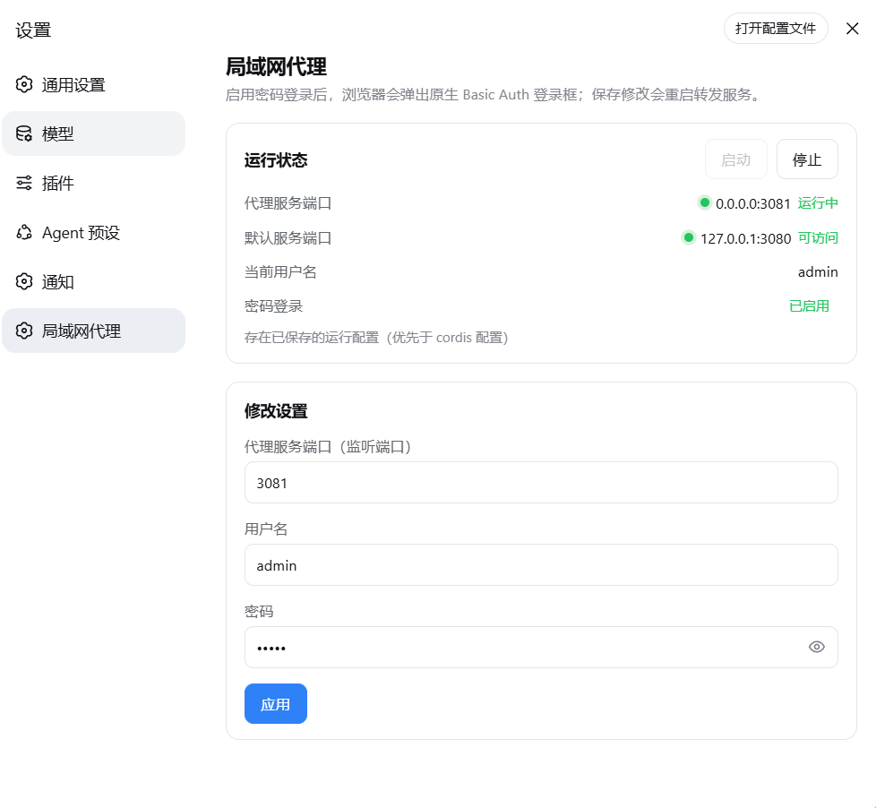

# dsh-proxy

[English](README.en.md) | 中文

HTTP + WebSocket 反向代理：把局域网端口转发到本地 DSH 服务 `127.0.0.1:3080`。
支持 Basic Auth、局域网访问、`crypto.randomUUID` polyfill 注入。

## DSH 插件版（推荐 · dsh-proxy）

**推荐 DSH（DeepSeek Harness）用户使用**：把代理作为插件装进 `web` 或 `desktop` profile，**随 `dsh web` / 桌面应用启停**，无需单独进程、无需下载可执行文件，带完整设置页面。

- 与独立版相同的原生 **Basic Auth**（浏览器弹窗）与 HTTP + WebSocket 全协议转发
- **设置页面**（DSH 设置 → 局域网代理）：状态红绿灯、启动/停止、改代理监听端口、用户名密码与免 token 登录开关（表单回写当前值，留空即设为空）
- 默认空凭据 = 密码登录关闭；**同时设置**用户名和密码才启用
- 可选的**免 token 首次访问**（`skipLaunchToken`，默认关闭）：由代理代替浏览器完成 DSH 启动 token→cookie 兑换，无需任何人粘贴 token——因为它会移除 DSH 自身的 token 校验，请与用户名密码搭配使用

<p align="center">
  
</p>

### 安装

插件按 profile 安装，Web 端与桌面端相互独立：只对谁生效就装谁，两边都用就各装一次。

**① Web 端（`dsh web`，命令行安装）**

在线安装（推荐）——直接从 GitHub 安装（无需下载仓库）：

```bash
dsh plugin --profile web add github:smanx/dsh-proxy#master
```

本地安装（仓库已克隆/下载到本机）：

```bash
dsh plugin --profile web add file:C:/mydata/codes/dsh-proxy
```

核对与卸载走同一命令：把 `add <spec>` 换成 `ls` 或 `remove @smanx/dsh-proxy`。

**② 桌面端（DeepSeek Harness 桌面应用）——在应用内安装**

桌面应用左侧栏的 **「插件」面板** → **「添加插件」**，在输入框里填入：

- 在线安装（推荐）：`github:smanx/dsh-proxy#master`
- 本地安装（仓库已克隆/下载到本机）：`C:/mydata/codes/dsh-proxy`

该输入框接受包名、Git 地址、压缩包和本地绝对路径。安装完成后**完全退出桌面应用再重新打开**即生效；核对与卸载都在同一个面板（**「已安装」**列表里应出现 `@smanx/dsh-proxy`）。

> 桌面端**不要**用终端命令安装：`desktop` profile 由 Electron 独占持有，npm 版 `dsh` 会直接拒绝它的插件管理请求（`error: profile "desktop" is managed exclusively by the Electron application`），只能走上面的图形界面。

桌面应用的内置服务端口由应用分配，插件默认 `upstreamPort: 0` 自动跟随实际端口，无需手动配置；设置入口与 Web 端相同（设置 → 局域网代理）。

重启 `dsh web`（桌面端则重启应用）后，访问 `http://<局域网IP>:3081` 即弹 Basic Auth 登录框。详细说明见 [`dsh-proxy/README.zh.md`](dsh-proxy/README.zh.md)。

## 独立可执行版本（go/ 与 node/）

不使用 DSH、或需要独立进程时的备选方案：两个等价的单文件版本（交互式启动、配置记忆、CLI 免交互参数）。

**下载安装**：从 [GitHub Releases](https://github.com/smanx/dsh-proxy/releases) 下载对应平台的单个可执行文件（Go 版约 6-7 MB / Node 版约 80-120 MB），放到任意目录直接运行；macOS/Linux 先 `chmod +x`。

| 目录 | 语言 | 单文件体积 | 说明 |
|---|---|---|---|
| [`go/`](go/) | Go（静态编译） | 6-7 MB | 轻量版；Go 标准库实现，体积小 95%，推荐 |
| [`node/`](node/) | Node.js（SEA 打包） | 83-119 MB | 原版；用 Node 官方 SEA 打包，无需安装 Node |

### 功能

- HTTP + WebSocket 反向代理（Go 版用标准库 `httputil.ReverseProxy`，原生支持 WS 升级）
- Basic Auth（默认 `admin/admin`，HTTP 与 WS 握手统一校验；公开静态资源如
  `/manifest.webmanifest` 免认证，避免浏览器抓取 manifest 时报 401）
- Origin 对齐 + Host 改写（通过 DSH `/api` 同源校验，LAN 访问 WS 不 403）
- HTML 注入 `crypto.randomUUID` polyfill（LAN 非安全上下文下实时通道可用）
- dsh 0.1.1+ 客户端 loopback 信任补丁：重写所服务的 JS，使设置页模型列表等在
  LAN 访问下不再报 "settings are unavailable in this browser"（与插件版行为一致）
- 交互式启动：4 项配置预填可编辑（源端口 3080 / 目标端口 3081 / admin / admin），**端口与账号密码均可手动修改**
- 配置记忆：`config.json` 存于可执行文件同目录，下次启动自动预填
- CLI 免交互参数（供计划任务/自动化）：
  `dsh-proxy --source-port 3080 --target-port 3081 --user admin --pass admin`

### 构建

```bash
# Node 版（产物在 node/dist/）
cd node
npm install
npm run build          # 全部 5 个平台（首次需下载 Node 二进制，之后缓存于 .sea-cache/）
npm run build:win      # 只构建 Windows

# Go 版（产物在 go/dist/，无需安装 Go 运行时）
cd go
./build.ps1            # 全部 5 个平台
./build.ps1 -Target win-x64
```

产物清单（两个版本各 5 个平台：`win-x64`、`linux-x64`、`linux-arm64`、`macos-x64`、`macos-arm64`）：
- Node 版：`dsh-proxy-<平台>`（如 `dsh-proxy-win-x64.exe`）
- Go 版：`dsh-proxy-go-<平台>`（如 `dsh-proxy-go-win-x64.exe`，避免与 Node 版同名）

macOS/Linux 版传到对应系统后先 `chmod +x`。

启动横幅显示的版本号在打包时注入：CI 自动取标签版本（如 `v1.1.0`）；
本地构建可用 `-Version`（Go）或 `--version`（Node）指定，缺省取最近 git 标签。

### 验证

```bash
# 免交互启动（示例端口 3091）
./dsh-proxy-win-x64.exe --source-port 3080 --target-port 3091 --user admin --pass admin

# 无凭据 → 401；带凭据 → 200
curl -i http://127.0.0.1:3091/
curl -u admin:admin http://127.0.0.1:3091/

# WebSocket 握手 → OPEN
node -e "const ws=new WebSocket('ws://127.0.0.1:3091/api/events.mux',{headers:{Authorization:'Basic '+Buffer.from('admin:admin').toString('base64')}});ws.onopen=()=>{console.log('OPEN');ws.close()}"
```

## 自动发布

推送 `v*` 标签会同时触发两条独立的工作流，各自成败、互不依赖：

| 工作流 | 产出 | 触发条件 |
|---|---|---|
| `.github/workflows/release.yml` | Node 版 + Go 版共 10 个单文件程序，发到 GitHub Release（含 SHA256SUMS.txt） | `v*` 标签，或 Actions 页面手动触发 |
| `.github/workflows/npm-publish.yml` | 插件包 `@smanx/dsh-proxy` 发到 npm（带 provenance） | `v*` 标签，或手动触发 |

发布 npm 前需要在仓库 **Settings → Secrets and variables → Actions** 里配一个名为 `NPM_TOKEN` 的 Secret：npmjs 上生成的 **Granular Access Token**（只授予本包 Read/Write）或 Automation token，它能绕过账号 2FA。

版本号以仓库里的清单为准，工作流**只核对不改写**：标签 `v0.1.5` 必须与根 `package.json` 和 `dsh-proxy/package.json` 的 `version` 三者一致，否则直接失败——这是为了防止根清单与插件清单版本漂移（发布读的是根清单，`main` 指向 `dsh-proxy/lib/index.cjs`）。发布前工作流还会跑 `pnpm install --frozen-lockfile && pnpm run check`（typecheck + 测试 + 重建 `lib/`），**打包用的是刚重建出来的产物**，所以发布内容一定与该标签的源码一致。仓库里已提交的 `dsh-proxy/lib/` 只是 `github:` / `file:` 直装路径的便利产物；它与 Linux 上的重建结果不必逐字节相同（实测差异在 `index.cjs` 与两个 `.map`），不一致时工作流只给出警告，不拦发布。

```bash
# 一次完整发版
pnpm run check                                   # 在 dsh-proxy/ 下，绿了再往下
npm version 0.1.5 --no-git-tag-version           # 根清单；同时手动同步 dsh-proxy/package.json
git commit -am "build: release 0.1.5" && git push
git tag v0.1.5 && git push origin v0.1.5         # 两条工作流同时开始
```

已发布过的版本不会被重复发布（npm 不允许覆盖同一版本），重跑会跳过。发布成功后即可用包名安装：

```bash
dsh plugin --profile web add @smanx/dsh-proxy
```

桌面端在应用内「插件 → 添加插件」填 `@smanx/dsh-proxy`。注意插件管理器先问**它配置的注册表**，国内镜像对新版本有同步延迟，装不到时在安装对话框的「安装源」里改用 npm 官方源。
